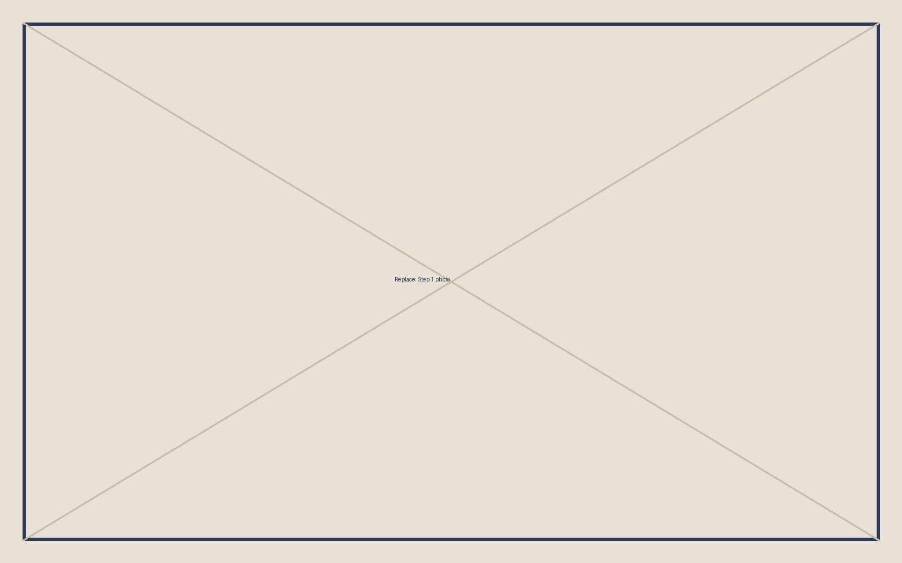

# Assembly guide

**Time:** about X hours · **People:** 1–2 · **Difficulty:** intermediate

## Tools

- 

## 

## Step 1: Short imperative title

What to do, in plain sentences. Reference parts by their BOM id, like (BOM #2).

!!! warning "Watch out"
    The mistake we made here and how to avoid it.

## Step 2: Short imperative title

Instructions.

!!! tip
    A trick that saves time.

## Step 3: Test it

How to check that the build works before calling it done.
