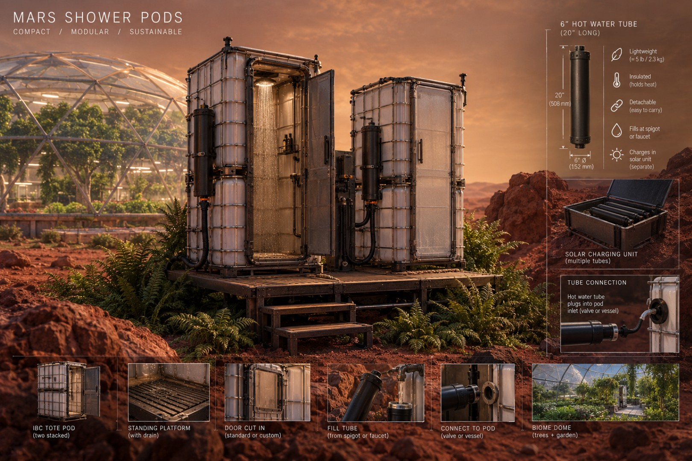

---
---

# Mars Shower Pods

**Status:** Early design 

**Maker:** Tyler Disney · Mars College Dept of Makers, 2027

**Brief Summary:**
Offgrid solar shower pods. The intent of this project is to build low-cost, self-contained, durable shower pods appropriate for remote and offgrid locations. This is the project of Tyler Disney, a Maker-in-Residence at Mars College 2027.

## Documentation

- [How It Works](how-it-works.md)
- [Project Log](log.md)
- [Build It Yourself](build-it.md)

