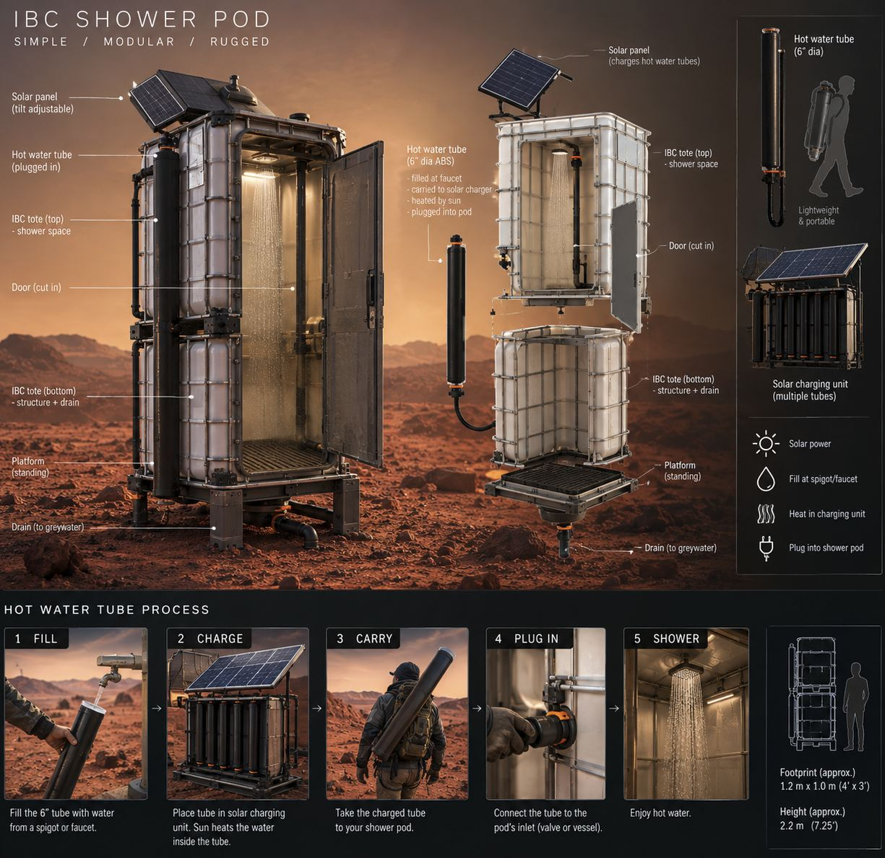

---
---
# The Doom Shower Project Journal

### 20261018 Update

working on the cms.

### 20261013 Project Brief

This project is organized as a bare minimum objective with explorative stretch goals as time and serendipity permit. The minimum objective is to build 2 solar shower pods at Mars that are:

- Wind sheltered
- Very water efficient (~2.5gal/shower)
- Safe (no scalding, no legionnaires, well lit, etc)
- Deals with greywater reasonably well.

The initial concept is for each pod to be constructed of two IBC totes stacked with a door cut in, a standing platform, and drain. The hot water "tanks" are to be individual 6" dia ABS tubes that are easily detached and placed in a separate solar charging device. The tube is easily carried and filled from a spigot or faucet, charged, and then plugged into the shower pod which has either a valve or vessel for taking in the hot water. 

With individual hot water tanks, everyone can see after their own hot water and it is impossible for one person to (accidentally?) drain a communal hot water tank. 

Minimum greywater strategy is TBD, I need to learn more about how greywater has been dealt with in the past and what the plan is this year. 

#### Stretch Goals

- Build a recirculating shower system based on [https://www.instructables.com/Showerloop/](https://www.instructables.com/Showerloop/)
- Exterior cladding to UV protect the totes (mud plaster panels, burlapcrete, salvaged paneling, etc).
- Occupied/nonoccupied lights
- HW tank insulated storage so you can have your shower at night after charging during the day
- A mechanical advantage system to lift the tanks into position
- Direct-PV water heating with surplus energy during the day (controls for suprlus harvesting as well as temperature control. People could fill their personal tanks from a main Domestic HW Tank.)

#### Questions/Design features to explore:

- How hot will the tubes get, and how quickly?
- Under what conditions do the tubes scald?
- Are there thermostatic valves that function without high pressure? 
- Is it worth it to have a pressure charging system, or better to just have it gravity feed?

Documentation/Contribution Deliverables:

- Build Manual
- Retrospective on what worked and what didn't
- Surprising outcomes/effects (good/bad/weird)
- Teach workshops for others to build their own?

#### Some reference builds:

Tons of good ideas in this video: [https://www.youtube.com/watch?v=XP12uxLF4ZU&t=1s](https://www.youtube.com/watch?v=XP12uxLF4ZU&t=1s)